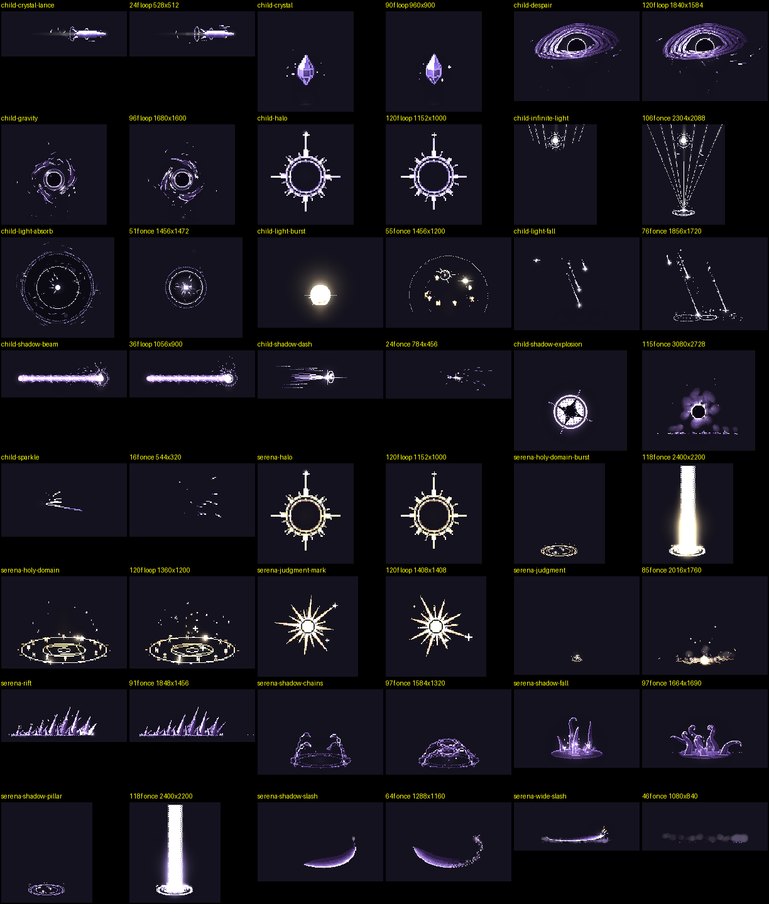
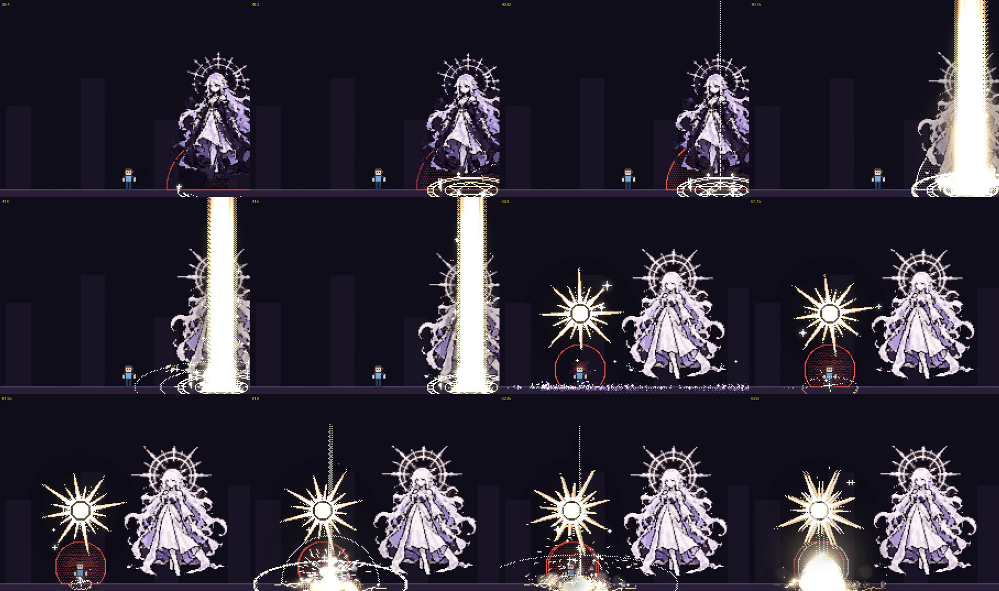
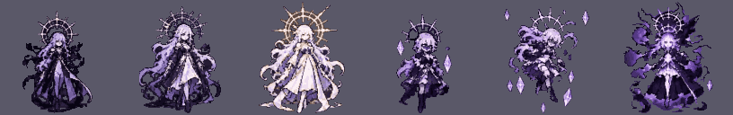
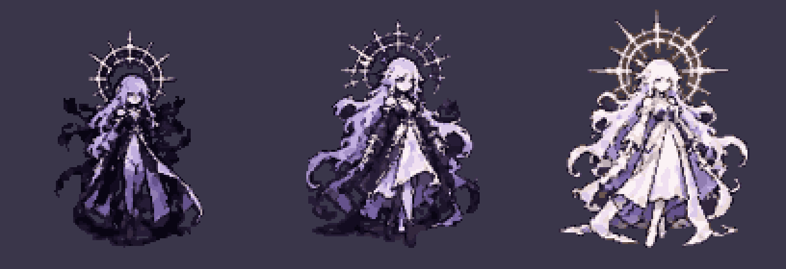
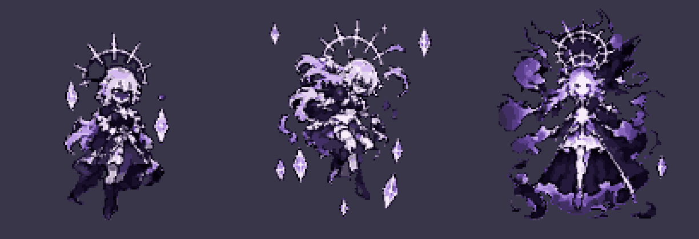
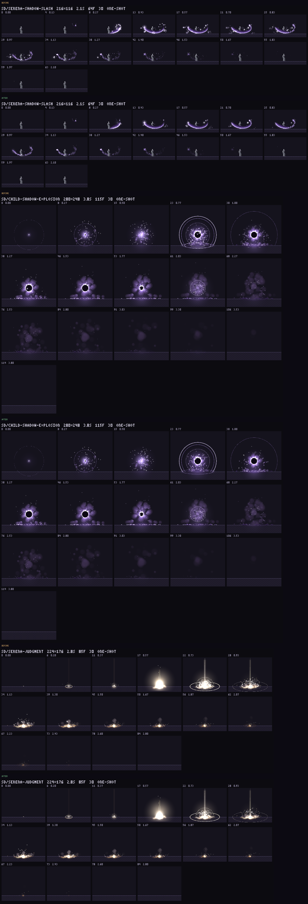
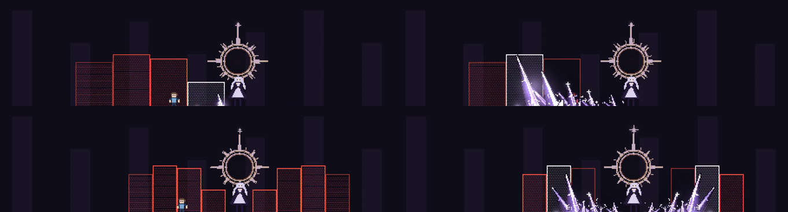
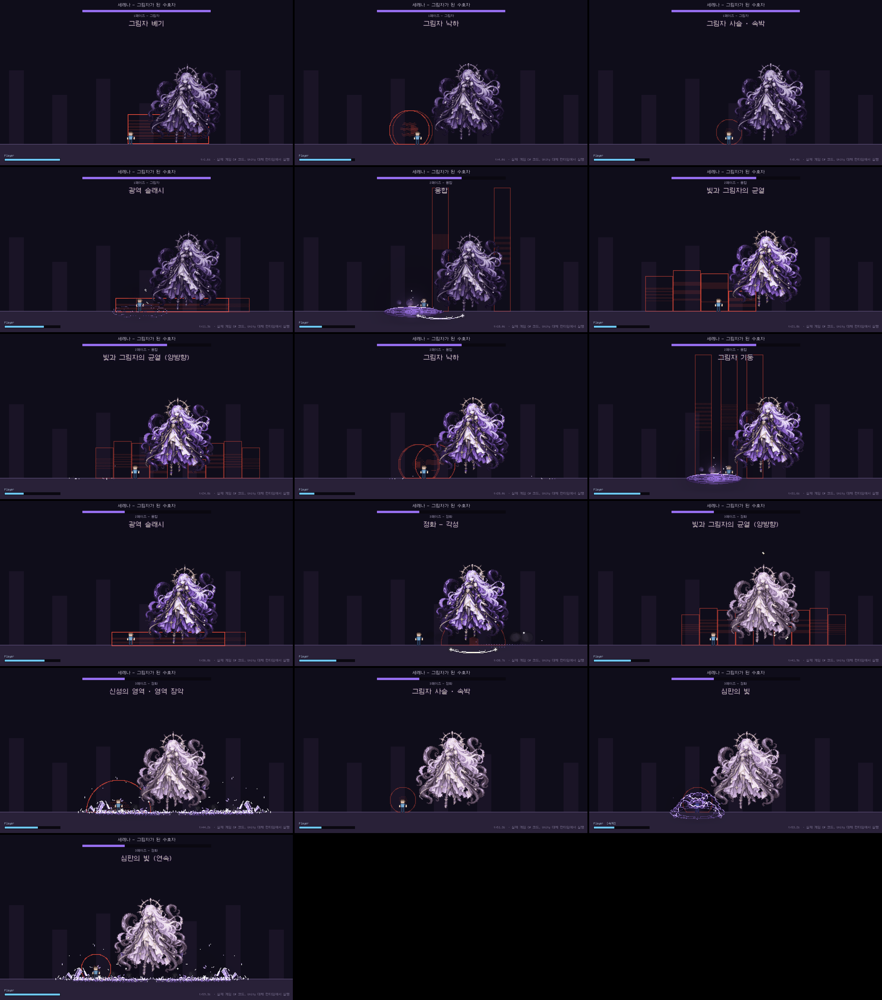
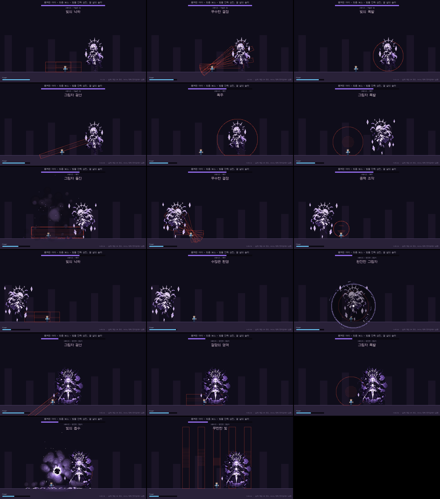
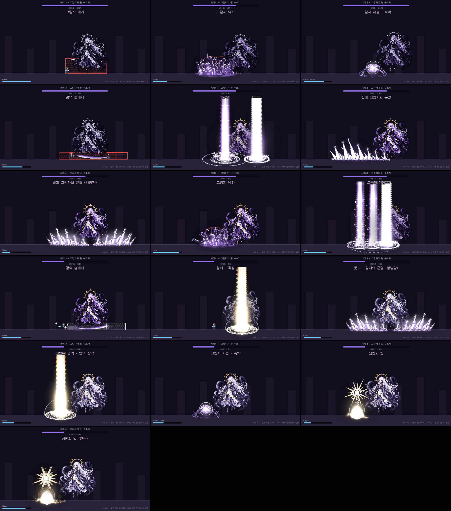

# 보스 스킬 — 세레나 · 움켜쥔 아이

컨셉 시트의 공격 패턴을 Unity 스킬 데이터로 구현한 것. 이펙트는 pixelfx(고정 버전)에서 컨셉 팔레트로 다시 칠하거나
새로 만든 스프라이트 시트다.

- 이펙트 목록: `tools/pixelfx/boss-fx.json` → `node tools/pixelfx/export-set.mjs tools/pixelfx/boss-fx.json`
  → `Assets/PixelFx/Sheets/bosses/` (팔레트: DUSK 그림자 보라, HALO 세레나의 금빛, CRYSTAL 아이의 라벤더 빛)
- 새로 만든 이펙트: `shadow/shadow-chains`(그림자 사슬), `holy/thorn-halo`(두 보스의 가시 후광)
- 스킬·보스 정의: `Assets/Game/Combat/Editor/BossLibrary.cs` → **Tools > Solar and Dark > Build Boss Assets**
  → `Assets/Game/Bosses/<Boss>/` (생성된 에셋은 인스펙터에서 자유롭게 조정 가능, 다시 빌드하면 덮어씀)
- 테스트 씬: **Tools > Solar and Dark > Create Boss Arena > 세레나 / 움켜쥔 아이** → Play
  (←/→ 이동, Shift 대시, Z 공격, 1–3 페이즈 점프, N 다음 스킬 강제, R 리셋)

## 보스 몸 스프라이트 (컨셉 아트 그대로, 128×128)

- 세레나: 고해상도 원화 `art/bosses/concept/serena-hires.jpg`(흰 배경, 컷아웃 `art/bosses/cutouts/serena-hires.png`)에서 만든다.
  2페이즈는 원화 그대로, 1·3페이즈는 원화의 그림에 시트 패널(`serena-p<n>-sheet.png`)의 색을 입힌다(같은 밝기 순위의
  패널 색으로 60 %, 3페이즈는 원화의 금색 유지). 페이즈마다 팔레트 20색. 고해상도 원화는 줄이기 전에 색 영역을 평탄화(mean shift)해서 음영 결이 점 노이즈로 뭉개지지 않게 한다.
- 원본(아이): `art/bosses/concept/sheet-1.webp`의 페이즈별 그림. `tools/sprites/cut.py`가 배경을 지운 결과가 `art/bosses/cutouts/`
  (패널 가장자리에서 배경 그라데이션을 따라 채우기 + 애니메 캐릭터 분할 모델 isnet-anime. 모델은 이 단계에만 쓰는 로컬 도구이고
  게임에 들어가지 않는다. 결과를 커밋해 두었으니 다시 자를 때만 필요).
- `python3 tools/sprites/make.py` → `Assets/PixelFx/Sheets/characters/<boss>-p<n>-{idle,cast,hurt}`. 보스마다 세 페이즈를
  같은 배율로 줄이고(가장 큰 것이 124×124, 발은 바닥에서 2 px 위), 그 보스의 그림에서 뽑은 32색 팔레트로 맞춘다.
  새로 그린 부분은 없다.
- 변환: 가장자리를 지키는 노이즈 제거 → 국소 대비 복원(강하게) → 축소 → 보스별 20색 → 외톨이 픽셀 정리(모드 필터) →
  도트 정리(`crisp`): 후광 고리 안으로 비치던 탁한 그림자 덩어리 제거(고리와 살은 1–2 px 선이라 남는다),
  밝은 색이 바깥과 닿는 가장자리에 어두운 테두리(실루엣은 커지지 않음).
- 페이즈 전환: 등장 스킬이 있으면 몸은 그 이펙트가 터지는 순간(첫 판정이 켜지는 때)에 바뀐다. 각성은 빛기둥이 번쩍일 때.
- 심판의 빛: 해가 대상을 따라가다 번개가 정해지는 순간 멈춰 그 자리에 머물고, 번개는 그 해에서 떨어진다(연속은 해 셋, 번개마다 하나).
  
- 애니메이션은 그 픽셀을 옮기기만 한다(최근접 샘플링, 밝아지는 순간도 같은 팔레트 안의 밝은 색으로).
  - idle 16프레임 10 fps 루프: 1 px 떠오름, 허리 아래가 줄 단위로 통째로 흔들림(아래로 갈수록 크게, 한 줄 안에서 픽셀이 찢기지 않음), 떨어진 조각은 각자 떠다님.
  - 공격 동작 3종(12프레임 12 fps), 스킬마다 `BossSkill.bodyMotion`으로 고른다(`BossLibrary.Motion`):
    - strike: 뒤로 젖혔다가 앞으로 파고들며 휘두름 — 그림자 베기, 광역 슬래시, 그림자 돌진
    - slam: 떠올랐다가 놓는 순간 내리꽂음 — 그림자 낙하, 균열, 그림자 기둥, 융합, 빛의 폭발, 그림자 폭발, 폭주
    - channel: 빛을 모으며 떠올라 주문이 이어지는 동안 빛난 채 유지(5–10프레임 반복) — 영역, 심판, 광선, 결정, 흡수 등
  - 4번째 프레임(0.33 s)이 놓는 순간: `BossBody`가 이 프레임을 스킬 선딜 끝, 곧 이펙트가 터지는 순간에 맞춘다.
    channel은 스킬이 끝날 때까지(`ActiveLength - windup`) 유지한다. 그림이 있는 몸에는 보라색 깜빡임(castTint)을 쓰지 않는다.
  - 아이의 손에서 나가는 스킬(광선, 빛의 폭발, 폭주, 흡수, 결정 고리)은 손 높이(3.1)에서 나간다.
  - hurt 6프레임 12 fps: 번쩍임과 뒤로 밀림. 공격 중에는 재생하지 않는다.
- 스프라이트에 후광이 그려져 있으므로 페이즈의 후광 이펙트(`sd/*-halo`)는 끔. 피격 범위는 몸통(반지름 1.5, 발에서 3.2 위).
  
  
  

## 이펙트 레이어

- 각 스킬 이펙트는 `third_party/pixelfx/src/fx/sd/<시트 이름>.js`: 라이브러리 이펙트(컨셉 팔레트)에 그 이펙트의 박자에 맞춘
  2차 움직임을 얹은 것. 조정은 `sd/_skills.js` 한 곳에서 (도우미: `sd/_alive.js`, 모두 t의 순수 함수라 루프 이음새 없음).
- 절제 원칙: 이펙트 본체가 스킬을 보여 준다. 그 위에 얹는 것은 최대 3가지, 각자 할 일이 하나씩:
  접촉 순간의 박자(불꽃 또는 파편), 남는 것 하나(티끌 또는 연기, 드문드문), 맞은 자리의 바닥 자국.
  섬광·충격파·룬·빛줄기를 겹겹이 쌓지 않는다.
  

## 피격 범위 표시 (텔레그래프)

- 공격 패턴이 시작되는 순간(선딜 시작) 그 패턴의 피해 판정 범위가 모두 붉은 표시로 깔린다. 채움이 차오르며 맞는 순간
  하얗게 번쩍인다. 색은 보스 이펙트에 없는 붉은 주황(`TelegraphMarker.DangerColor`)이라 이펙트와 섞이지 않는다.
- 돌진은 지나갈 경로 전체, 투사체는 날아올 길(목표 지점 조금 너머까지), 바닥 원은 바닥 위 반원으로 표시한다.
  플레이어를 따라오는 표시(심판의 빛)는 공격이 생성되는 순간 그 자리에 멈춘다.
  오래 남는 판정(영역·기둥 등)은 살아 있는 동안 윤곽선이 남는다. 피해 없는 끌어당김·장식 큐는 표시하지 않는다.
- 빛과 그림자의 균열: 판정이 가시 모양을 따른다. 줄을 네 칸으로 나눠 각 칸 높이를 그 칸의 가장 높은 가시에 맞추고, 균열 끝이
  그 칸에 닿을 때 판정이 켜진다(이펙트의 상수 START 0.04 s, RUN 0.44 s 그대로). 양방향은 한쪽 7 유닛(`sd/serena-rift-short`)이라
  양 끝 너머와 세레나 발밑이 안전하다.
  
- 가장 짧은 경고 시간은 0.6초(그림자 베기)이며, 대부분 0.8~2초다. `tools/arena-sim`에 `SIM_AUDIT=1`을 주면 전부 출력된다.
  
  

## 스스로 점검하는 도구

- 판정과 이펙트 비교: `SIM_AUDIT=1 dotnet tools/arena-sim/bin/Release/net8.0/arena-sim.dll serena . 2> cues.jsonl` 후
  `python3 tools/arena-sim/audit.py cues.jsonl <폴더>`. 스킬마다 판정이 켜진 순간의 이펙트 위에 판정 범위를 그리고,
  이펙트가 판정 밖에서 그려지는 비율(in)과 판정이 빈 곳까지 닿는 비율(fill)을 출력한다.
- 회피 검사: `SIM_DODGE=1 tools/arena-sim/run.sh all records/arena-dodge`. 플레이어가 붉은 표시를 읽고 걷거나 대시로 빠진다.
  그래도 맞는 공격은 피할 수 없는 공격이다. 현재 두 보스 모두 0히트(`arena-serena-dodge.mp4`, `arena-hidden-child-dodge.mp4`).

## 실행 영상 (Unity 없이)

`tools/arena-sim/run.sh [serena|child|all]`: 게임의 실제 C# 스크립트(BossLibrary, BossArenaScene, 보스 AI, 스킬 러너,
판정, pixelfx 재생)를 작은 Unity 대체 런타임(`tools/arena-sim/UnityShim.cs`)에서 돌려 영상으로 렌더링한다. 플레이어
대역은 보스 앞에 서 있고, 페이즈 순서대로 각 스킬을 한 번씩 강제 시전한다. 물리·Animator·OnGUI는 없으니 최종 확인은
Unity에서.

- [세레나](arena-serena.mp4) · [움켜쥔 아이](arena-hidden-child.mp4)

## 시스템

| 부분 | 파일 | 하는 일 |
|---|---|---|
| 스킬 데이터 | `BossSkill.cs` | 선딜(windup) → 큐 타임라인 → 후딜. 큐 = 이펙트 시트 + 위치(자신/대상/대상 추적/대상 주변 라인·랜덤/자신 주위 원/대상 양옆) + 조준(대상 향하기/반대/회전) + 판정 |
| 판정 | `SkillRunner.cs` `HitVolume` | 원/박스, 지연(이펙트 접촉 프레임에 맞춤), 지속·틱, 피해, 넉백, 히트스톱, 화면 흔들림, 속박, 끌어당김 |
| 예고 | `TelegraphMarker.cs` | 판정 지역을 바닥에 픽셀 외곽선으로 표시, 판정 직전까지 채워지며 깜빡임 |
| 보스 AI | `BossController.cs` | 거리 유지, 쿨다운·거리·가중치로 스킬 선택, HP 비율로 페이즈 전환(진입 스킬 동안 무적), 페이즈별 후광·색 |
| 특수 행동 | `CueAction` | 돌진(잔상), 자기 회복, 환영 소환(각 환영이 하위 스킬 시전) |
| 맞는 쪽 | `Health` `Hurtbox` `StatusReceiver` | 체력·무적 프레임, 원형 피격 판정(물리 불필요), 속박·넉백·끌림 |

단위: 16 px = 1 유닛(이펙트 원본 스케일, 38 px 캐릭터 = 2.4 유닛). 판정 시각은 각 이펙트 코드의 상수에서 가져왔다
(예: `holy/smite` HIT 0.54 s, `holy/holy-pillar` HIT 0.66 s, `arcane/magic-circle-cast` FLASH 1.52 s).

## 세레나 — 그림자가 된 수호자 (HP 1400)

| 페이즈 | HP | 스킬 |
|---|---|---|
| 1 그림자 | 100% | 그림자 베기, 그림자 낙하, 그림자 사슬, 광역 슬래시 |
| 2 융합 | 66% (진입: 양옆 그림자 기둥) | + 빛과 그림자의 균열(단/양방향), 그림자 기둥 |
| 3 정화 | 33% (진입: 빛 기둥 넉백) | 그림자 베기, 균열(양방향), 그림자 기둥, 신성의 영역, 심판의 빛(단/연속), 사슬 |

| 스킬 | 이펙트 | 패턴 | 판정 |
|---|---|---|---|
| 그림자 베기 | scythe-reap (DUSK) | 근접, 대상 쪽으로 초승달 베기 | 박스 5×3, 0.14 s, 12 + 넉백 |
| 광역 슬래시 | spear-sweep (DUSK) | 앞 → 0.5 s 뒤 뒤쪽, 낮은 휩쓸기 | 박스 11×1.4 ×2, 10씩 |
| 그림자 낙하 | shadow-tendrils (DUSK) | 대상 주변 3곳에 0.4 s 간격 그림자 웅덩이 + 촉수 | 원 r2, 1.1 s 동안 0.45 s 틱 8 |
| 그림자 사슬 · 속박 | **shadow-chains** (신규) | 대상 발밑 문양 → 사슬이 감아 묶음 | 원 r1.3, 0.78 s, 6 + 속박 1.2 s |
| 빛과 그림자의 균열 | ice-spikes (DUSK) | 바닥을 타고 대상 쪽으로 가시 균열 (2페이즈+ 양방향) | 박스 10.75×3, 14 |
| 그림자 기둥 | magic-circle-cast (DUSK) | 대상 주변 라인 3곳, 마법진이 그려진 뒤 기둥 | 박스 1.6×12, 1.52 s부터 0.9 s 틱 12 |
| 신성의 영역 · 영역 장악 | rune-circle → magic-circle-cast (HALO) | 대상이 선 바닥을 장악: 3.2 s 지속 피해 → 영역 전체 빛 기둥 폭발 (빠져나가야 함) | 원 r3.6 틱 3 / 폭발 22 + 넉백 |
| 심판의 빛 | sunburst → smite (HALO) | 대상 머리 위 별이 1.1 s 따라다니다 그 자리에 빛의 낙뢰 (3페이즈 3연속) | 원 r1.5, 22 |

## 움켜쥔 아이 — 최종 보스 (HP 2000)

| 페이즈 | HP | 스킬 |
|---|---|---|
| 1 억눌린 빛 | 100% | 빛의 낙하, 무수한 결정, 빛의 폭발, 그림자 광선 |
| 2 폭주 | 60% (진입: 빛의 폭발 넉백) | + 그림자 폭발, 그림자 돌진, 중력 조작, 수많은 환영 |
| 3 완전한 그림자 | 25% (진입: 빛의 흡수) | 그림자 폭발, 돌진, 중력, 환영, 절망의 영역, 빛의 흡수, 무한한 빛, 광선 |

| 스킬 | 이펙트 | 패턴 | 판정 |
|---|---|---|---|
| 빛의 낙하 | star-fall (CRYSTAL) | 대상 주변에 빛의 파편이 비처럼 2회 | 원 r2.9, 틱 6 |
| 무수한 결정 | ice-crystal → ice-lance (CRYSTAL) | 주위에 결정 6개가 피어나 떠 있다가 하나씩 대상에게 발사 | 투사체 r0.45, 6씩 |
| 빛의 폭발 | mana-burst (HALO) | 근접, 모인 빛이 고리로 폭발 | 원 r3, 14 + 넉백 |
| 그림자 광선 | arcane-beam (DUSK) | 조준 후 1.8 s 광선 | 박스 14×0.9, 0.2 s 틱 4 |
| 그림자 폭발 | dark-explosion (DUSK) | 대상 위치에 검은 별 → 폭발 | 원 r3, 20 + 히트스톱 |
| 그림자 돌진 | thrust (DUSK) + 잔상 | 대상 관통 8 유닛 돌진 | 원 r1.1 (몸에 붙음), 14 |
| 중력 조작 | void-orb (DUSK) | 대상 위 공허가 3 s 동안 주변을 끌어당김 | 끌림 r7, 중심 틱 4 |
| 수많은 환영 | hit-spark (CRYSTAL) + 환영 | 대상 양옆에 환영 4체, 각자 결정 하나 투척 후 소멸 | 환영당 투사체 6 |
| 절망의 영역 | black-hole (DUSK) | 대상 위치에 5 s 블랙홀, 지속 피해 + 약한 끌림 | 원 r3.2, 0.4 s 틱 3 |
| 빛의 흡수 | implosion (CRYSTAL) | 모든 것을 끌어들이고 회복(4%) 후 폭발 | 끌림 r8, 폭발 18 |
| 무한한 빛 | holy-pillar (CRYSTAL) | 대상을 가로지르는 라인에 빛 기둥 5개가 차례로 | 박스 1.4×12, 틱 9 |

## 남은 일

- 몸 애니메이션은 기존 그림의 픽셀을 움직여 만든 것이라 걷기·베기 같은 새 자세는 없다. 새 자세가 필요하면 손으로 그리거나
  (Aseprite 파일 제공) PixelLab 같은 생성 도구로 만든 뒤 같은 시트 이름으로 내보내면 된다. 스킬 시작 시
  `BossController.onSkill`과 애니메이터 트리거(`animTrigger`)도 나간다.
- 수치(피해·쿨다운·범위)는 첫 버전. 아레나에서 N 키로 스킬을 하나씩 확인하며 에셋에서 조정.
