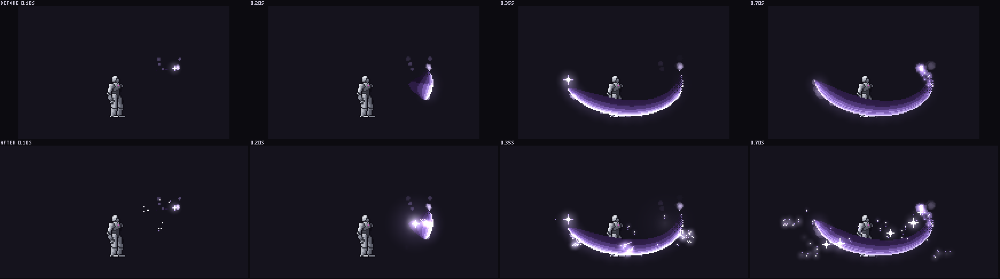
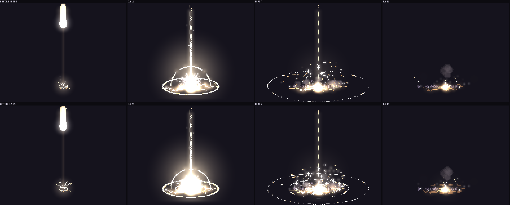
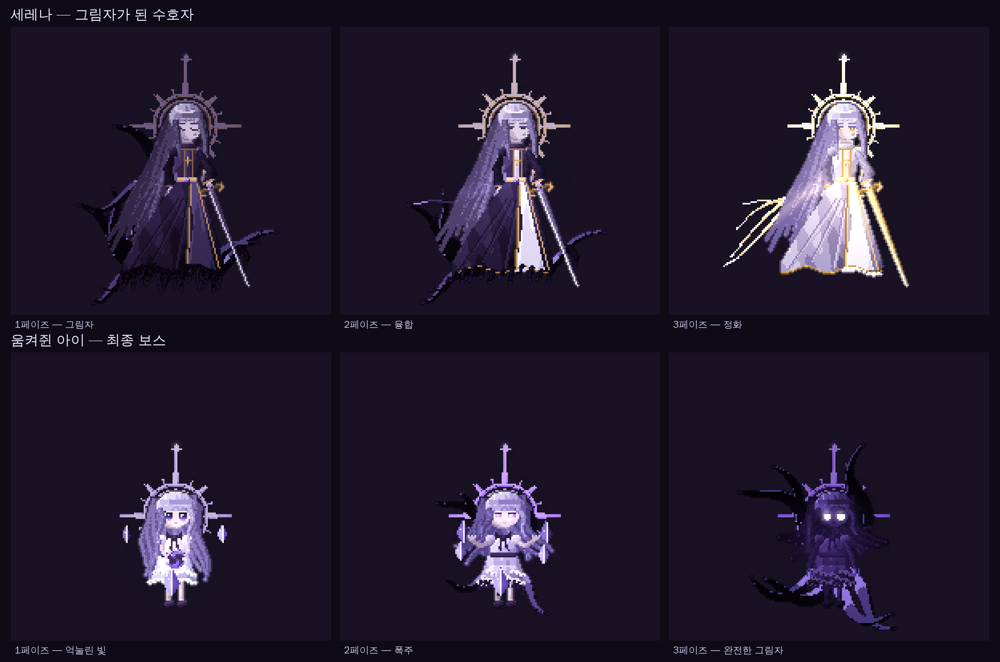
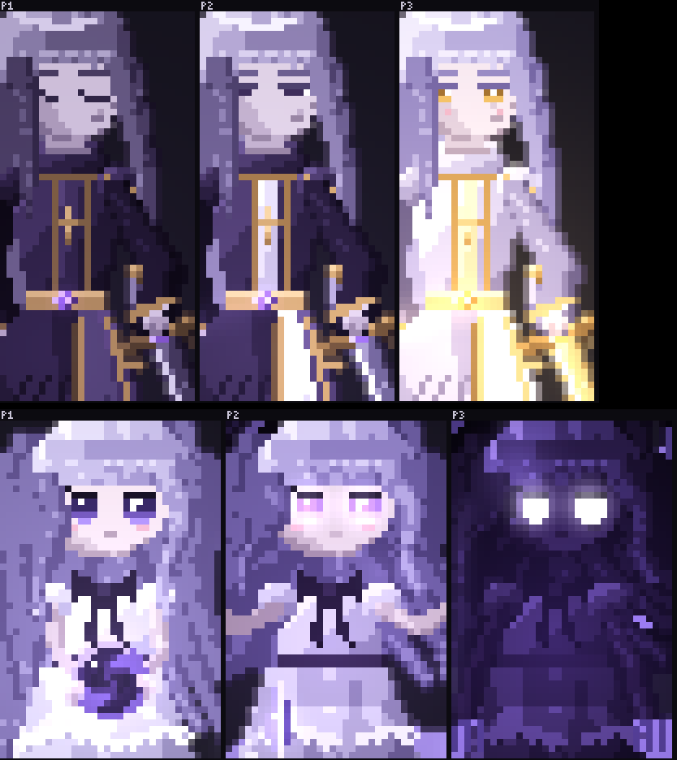
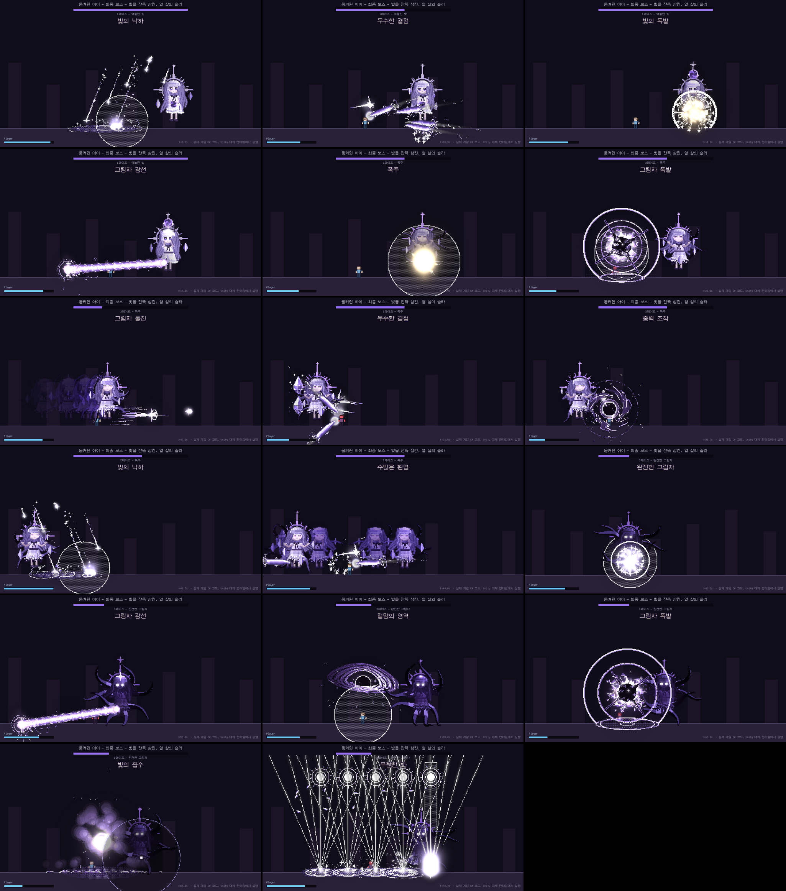

# 보스 스킬 — 세레나 · 움켜쥔 아이

컨셉 시트의 공격 패턴을 Unity 스킬 데이터로 구현한 것. 이펙트는 pixelfx(고정 버전)에서 컨셉 팔레트로 다시 칠하거나
새로 만든 스프라이트 시트다.

- 이펙트 목록: `tools/pixelfx/boss-fx.json` → `node tools/pixelfx/export-set.mjs tools/pixelfx/boss-fx.json`
  → `Assets/PixelFx/Sheets/bosses/` (팔레트: DUSK 그림자 보라, HALO 세레나의 금빛, CRYSTAL 아이의 라벤더 빛)
- 새로 만든 이펙트: `shadow/shadow-chains`(그림자 사슬), `holy/thorn-halo`(두 보스의 가시 후광)
- 스킬·보스 정의: `Assets/Game/Combat/Editor/BossLibrary.cs` → **Tools > Solar and Dark > Build Boss Assets**
  → `Assets/Game/Bosses/<Boss>/` (생성된 에셋은 인스펙터에서 자유롭게 조정 가능, 다시 빌드하면 덮어씀)
- 테스트 씬: **Tools > Solar and Dark > Create Boss Arena > 세레나 / 움켜쥔 아이** → Play
  (←/→ 이동, Shift 대시, Z 공격, 1–3 페이즈 점프, N 다음 스킬 강제, R 리셋)

## 생동감 레이어와 캐릭터

- 각 스킬 이펙트는 `third_party/pixelfx/src/fx/sd/<시트 이름>.js`: 라이브러리 이펙트(컨셉 팔레트)에 그 이펙트의 박자에 맞춘
  2차 움직임을 얹은 것. 방출 전에 빨려드는 기운, 접촉 순간의 불꽃·2중 충격파·섬광, 튀는 파편, 떠오르는 룬 문양,
  빛줄기, 바닥에 남는 그을음, 남아서 깜빡이는 반짝임, 피어오르는 티끌과 불씨, 어두운 연기. 조정은 `sd/_skills.js` 한 곳에서 (도우미: `sd/_alive.js`, 모두 t의 순수 함수라 루프 이음새 없음).
  
  
- 보스 캐릭터: `sd/_serena.js`, `sd/_child.js`에서 코드로 그린 도트. 세레나 약 120 px, 아이 약 80 px로 컨셉 시트의 디테일
  (윤기 링이 있는 머리와 웨이브 가닥, 애니메 눈, 금장 필리그리·벨트 보석, 갈라진 겉치마와 흰 속치마, 날홈·말린 가드의 장검,
  리본·프릴 레이스, 소용돌이 구슬, 면이 진 결정, 리본형 촉수)을 따른다.
  페이즈마다 대기(2초 루프)와 시전(1초, 0.35초에 베기/폭발, 대기 자세로 시작·끝) 시트 →
  `tools/pixelfx/boss-characters.json` → `Assets/PixelFx/Sheets/characters/`. Unity에서는 `BossBody`가 페이즈의 시트를 재생하고,
  시전은 베는 프레임이 스킬 선딜 끝에 맞도록 속도를 맞춘다.
  얼굴과 손은 픽셀 도안(`grid()`)으로 한 칸씩 찍는다: 3/4 얼굴형, 속눈썹·홍채 단계·하이라이트, 페이즈별 눈(감음/반쯤/뜸, 빛나는 눈),
  주먹 쥔 손과 손가락이 보이는 손.
  
  

## 실행 영상 (Unity 없이)

`tools/arena-sim/run.sh [serena|child|all]`: 게임의 실제 C# 스크립트(BossLibrary, BossArenaScene, 보스 AI, 스킬 러너,
판정, pixelfx 재생)를 작은 Unity 대체 런타임(`tools/arena-sim/UnityShim.cs`)에서 돌려 영상으로 렌더링한다. 플레이어
대역은 보스 앞에 서 있고, 페이즈 순서대로 각 스킬을 한 번씩 강제 시전한다. 물리·Animator·OnGUI는 없으니 최종 확인은
Unity에서.

- [세레나](arena-serena.mp4) · [움켜쥔 아이](arena-hidden-child.mp4)

## 시스템

| 부분 | 파일 | 하는 일 |
|---|---|---|
| 스킬 데이터 | `BossSkill.cs` | 선딜(windup) → 큐 타임라인 → 후딜. 큐 = 이펙트 시트 + 위치(자신/대상/대상 추적/대상 주변 라인·랜덤/자신 주위 원/대상 양옆) + 조준(대상 향하기/반대/회전) + 판정 |
| 판정 | `SkillRunner.cs` `HitVolume` | 원/박스, 지연(이펙트 접촉 프레임에 맞춤), 지속·틱, 피해, 넉백, 히트스톱, 화면 흔들림, 속박, 끌어당김 |
| 예고 | `TelegraphMarker.cs` | 판정 지역을 바닥에 픽셀 외곽선으로 표시, 판정 직전까지 채워지며 깜빡임 |
| 보스 AI | `BossController.cs` | 거리 유지, 쿨다운·거리·가중치로 스킬 선택, HP 비율로 페이즈 전환(진입 스킬 동안 무적), 페이즈별 후광·색 |
| 특수 행동 | `CueAction` | 돌진(잔상), 자기 회복, 환영 소환(각 환영이 하위 스킬 시전) |
| 맞는 쪽 | `Health` `Hurtbox` `StatusReceiver` | 체력·무적 프레임, 원형 피격 판정(물리 불필요), 속박·넉백·끌림 |

단위: 16 px = 1 유닛(이펙트 원본 스케일, 38 px 캐릭터 = 2.4 유닛). 판정 시각은 각 이펙트 코드의 상수에서 가져왔다
(예: `holy/smite` HIT 0.54 s, `holy/holy-pillar` HIT 0.66 s, `arcane/magic-circle-cast` FLASH 1.52 s).

## 세레나 — 그림자가 된 수호자 (HP 1400)

| 페이즈 | HP | 스킬 |
|---|---|---|
| 1 그림자 | 100% | 그림자 베기, 그림자 낙하, 그림자 사슬, 광역 슬래시 |
| 2 융합 | 66% (진입: 양옆 그림자 기둥) | + 빛과 그림자의 균열(단/양방향), 그림자 기둥 |
| 3 정화 | 33% (진입: 빛 기둥 넉백) | 그림자 베기, 균열(양방향), 그림자 기둥, 신성의 영역, 심판의 빛(단/연속), 사슬 |

| 스킬 | 이펙트 | 패턴 | 판정 |
|---|---|---|---|
| 그림자 베기 | scythe-reap (DUSK) | 근접, 대상 쪽으로 초승달 베기 | 박스 5×3, 0.14 s, 12 + 넉백 |
| 광역 슬래시 | spear-sweep (DUSK) | 앞 → 0.5 s 뒤 뒤쪽, 낮은 휩쓸기 | 박스 11×1.4 ×2, 10씩 |
| 그림자 낙하 | shadow-tendrils (DUSK) | 대상 주변 3곳에 0.4 s 간격 그림자 웅덩이 + 촉수 | 원 r2, 1.1 s 동안 0.45 s 틱 8 |
| 그림자 사슬 · 속박 | **shadow-chains** (신규) | 대상 발밑 문양 → 사슬이 감아 묶음 | 원 r1.3, 0.78 s, 6 + 속박 1.2 s |
| 빛과 그림자의 균열 | ice-spikes (DUSK) | 바닥을 타고 대상 쪽으로 가시 균열 (2페이즈+ 양방향) | 박스 10.75×3, 14 |
| 그림자 기둥 | magic-circle-cast (DUSK) | 대상 주변 라인 3곳, 마법진이 그려진 뒤 기둥 | 박스 1.6×12, 1.52 s부터 0.9 s 틱 12 |
| 신성의 영역 · 영역 장악 | rune-circle → magic-circle-cast (HALO) | 대상이 선 바닥을 장악: 3.2 s 지속 피해 → 영역 전체 빛 기둥 폭발 (빠져나가야 함) | 원 r3.6 틱 3 / 폭발 22 + 넉백 |
| 심판의 빛 | sunburst → smite (HALO) | 대상 머리 위 별이 1.1 s 따라다니다 그 자리에 빛의 낙뢰 (3페이즈 3연속) | 원 r1.5, 22 |

## 움켜쥔 아이 — 최종 보스 (HP 2000)

| 페이즈 | HP | 스킬 |
|---|---|---|
| 1 억눌린 빛 | 100% | 빛의 낙하, 무수한 결정, 빛의 폭발, 그림자 광선 |
| 2 폭주 | 60% (진입: 빛의 폭발 넉백) | + 그림자 폭발, 그림자 돌진, 중력 조작, 수많은 환영 |
| 3 완전한 그림자 | 25% (진입: 빛의 흡수) | 그림자 폭발, 돌진, 중력, 환영, 절망의 영역, 빛의 흡수, 무한한 빛, 광선 |

| 스킬 | 이펙트 | 패턴 | 판정 |
|---|---|---|---|
| 빛의 낙하 | star-fall (CRYSTAL) | 대상 주변에 빛의 파편이 비처럼 2회 | 원 r2.9, 틱 6 |
| 무수한 결정 | ice-crystal → ice-lance (CRYSTAL) | 주위에 결정 6개가 피어나 떠 있다가 하나씩 대상에게 발사 | 투사체 r0.45, 6씩 |
| 빛의 폭발 | mana-burst (HALO) | 근접, 모인 빛이 고리로 폭발 | 원 r3, 14 + 넉백 |
| 그림자 광선 | arcane-beam (DUSK) | 조준 후 1.8 s 광선 | 박스 14×0.9, 0.2 s 틱 4 |
| 그림자 폭발 | dark-explosion (DUSK) | 대상 위치에 검은 별 → 폭발 | 원 r3, 20 + 히트스톱 |
| 그림자 돌진 | thrust (DUSK) + 잔상 | 대상 관통 8 유닛 돌진 | 원 r1.1 (몸에 붙음), 14 |
| 중력 조작 | void-orb (DUSK) | 대상 위 공허가 3 s 동안 주변을 끌어당김 | 끌림 r7, 중심 틱 4 |
| 수많은 환영 | hit-spark (CRYSTAL) + 환영 | 대상 양옆에 환영 4체, 각자 결정 하나 투척 후 소멸 | 환영당 투사체 6 |
| 절망의 영역 | black-hole (DUSK) | 대상 위치에 5 s 블랙홀, 지속 피해 + 약한 끌림 | 원 r3.2, 0.4 s 틱 3 |
| 빛의 흡수 | implosion (CRYSTAL) | 모든 것을 끌어들이고 회복(4%) 후 폭발 | 끌림 r8, 폭발 18 |
| 무한한 빛 | holy-pillar (CRYSTAL) | 대상을 가로지르는 라인에 빛 기둥 5개가 차례로 | 박스 1.4×12, 틱 9 |

## 남은 일

- 캐릭터는 코드로 그린 첫 버전. 손그림으로 바꾸려면 `.aseprite`로 변환해 고친 뒤 같은 위치에 시트를 내보내면 된다
  (`docs/pixelfx-aseprite.md`). 스킬 시작 시 `BossController.onSkill`과 애니메이터 트리거(`animTrigger`)도 나간다.
- 수치(피해·쿨다운·범위)는 첫 버전. 아레나에서 N 키로 스킬을 하나씩 확인하며 에셋에서 조정.
